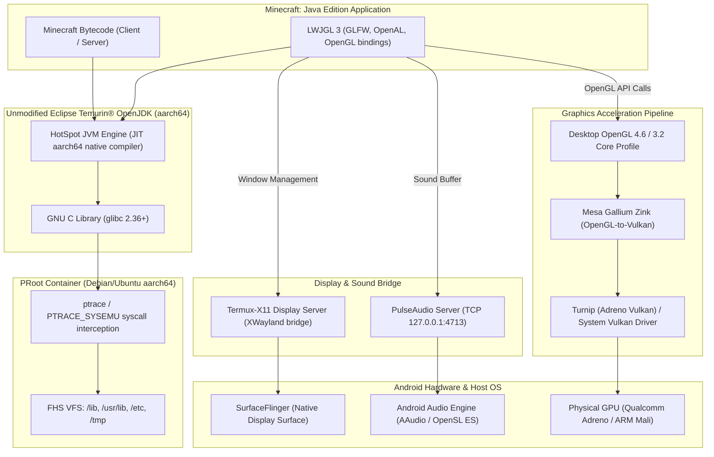

# Architecture: Running Minecraft Java Edition with Unmodified OpenJDK on Android

This document details the low-level systems architecture enabling **Minecraft: Java Edition** to execute on Android devices using an **unmodified 64-bit ARM (`aarch64`) desktop build of OpenJDK** (such as [Eclipse Temurin®](https://adoptium.net/temurin/)).

---

## 1. The Core Engineering Challenge

Desktop Java applications and standard desktop OpenJDK distributions (like Eclipse Temurin) are built for standard GNU/Linux distributions, while Android is fundamentally distinct:

| Layer | Standard Linux Desktop (Temurin Target) | Stock Android OS |
| :--- | :--- | :--- |
| **C Library (libc)** | GNU C Library (`glibc` >= 2.17) | Google Bionic C Library (`libc.so`) |
| **Dynamic Linker** | `/lib/ld-linux-aarch64.so.1` | `/system/bin/linker64` |
| **Filesystem Layout** | Filesystem Hierarchy Standard (`/usr`, `/etc`, `/lib`) | Android layout (`/system`, `/data/data/...`) |
| **Windowing System** | X11 (`libX11.so`) or Wayland (`libwayland-client.so`) | Android SurfaceFlinger (`ANativeWindow`) |
| **Graphics API** | Desktop OpenGL 3.2+ Core / OpenGL 4.6 | OpenGL ES 3.2 / Vulkan 1.3 |
| **Audio Engine** | PulseAudio / ALSA (`libasound.so`) | OpenSL ES / AAudio |
| **Memory Security** | Standard POSIX `mprotect` (PROT_READ\|PROT_WRITE\|PROT_EXEC) | Strict W^X (Write XOR Execute) SELinux enforcement |

### Why Unmodified OpenJDK Cannot Run Directly on Raw Android
If you extract an official Eclipse Temurin tarball (`OpenJDK21U-jdk_aarch64_linux_hotspot_*.tar.gz`) onto an Android filesystem and execute `./bin/java`, the kernel immediately fails with:
```
sh: ./java: No such file or directory
```
This error does **not** mean the `java` binary is missing; it means the ELF interpreter specified in the binary's ELF header (`PT_INTERP: /lib/ld-linux-aarch64.so.1`) cannot be found in Android's root filesystem. Furthermore, even if the interpreter path were patched, Temurin's shared libraries link directly against `glibc` symbols (`__libc_start_main`, `pthread_cancel`, etc.) that do not exist in Android Bionic.

---

## 2. System Architecture

Domrei solves these incompatibilities through a zero-root, modular translation architecture:



---

## 3. Component Deep Dive

### 3.1 PRoot: Syscall Virtualization
- **Mechanism**: Utilizes Linux `ptrace(2)` and `PTRACE_SYSEMU` to intercept system calls made by the unmodified Temurin OpenJDK runtime and the C library.
- **Path Resolution**: When Temurin or `glibc` requests `/lib/ld-linux-aarch64.so.1` or `/etc/resolv.conf`, PRoot redirects the request transparently to the container's root directory without requiring root privileges.
- **Memory Permissions (W^X Bypass)**: By intercepting `mmap(2)` and `mprotect(2)` calls, PRoot allows the HotSpot JIT compiler to allocate executable dynamic code pages for aarch64 machine code without triggering Android OS security exceptions.

### 3.2 Display Pipeline: Termux-X11
- Minecraft relies on GLFW to initialize a desktop window and receive input events (keyboard, mouse, touch).
- `termux-x11` runs as an Android background process and standalone Android Activity. It connects an internal X11 server socket directly to Android's `SurfaceControl` / `ANativeWindow`.
- Input events (touch taps, swipes, and physical Bluetooth keyboards/mice) are translated to standard X11 events (`KeyPress`, `MotionNotify`, `ButtonPress`) and sent to GLFW.

### 3.3 Graphics Pipeline: Mesa Zink + Turnip
- Minecraft 1.17+ mandates OpenGL 3.2 Core Profile; modern shaders (Iris / Sodium) require OpenGL 4.5+.
- Android provides only **OpenGL ES** and **Vulkan**. OpenGL ES lacks desktop features (such as quad primitives, line widths, and specific polygon modes).
- **Zink**: An open-source Gallium driver in Mesa that implements full desktop **OpenGL 4.6** on top of Vulkan.
- **Turnip**: Mesa's open-source Vulkan driver for Qualcomm Adreno GPUs. When combined (`ZINK + Turnip`), OpenGL calls bypass Android driver overhead and map directly to hardware Vulkan commands with near-native desktop performance.

### 3.4 Audio Pipeline: PulseAudio TCP Bridge
- Unmodified OpenAL loads `libpulse.so` to communicate with a sound server.
- Domrei initializes PulseAudio with a local loopback TCP listener:
  ```bash
  pulseaudio --start --load="module-native-protocol-tcp auth-ip-acl=127.0.0.1 auth-anonymous=1"
  ```
- Minecraft's OpenAL audio stream is delivered with low latency to Android's native audio mixer.

---

## 4. Comparing Approaches

| Feature | Domrei (PRoot + Unmodified Temurin) | PojavLauncher Standard | Box64 / Wine Translation |
| :--- | :--- | :--- | :--- |
| **JDK Build** | **100% Unmodified Eclipse Temurin aarch64** | Custom-patched Bionic OpenJDK fork | Desktop x86/x86_64 OpenJDK |
| **Architecture** | Native 64-bit ARM (`aarch64`) | Native 64-bit ARM (`aarch64`) | Emulated x86_64 -> aarch64 |
| **JIT Performance** | **Full Native CPU Speed** | Full Native CPU Speed | High emulation overhead (30-50% loss) |
| **Mod Compatibility** | **High** (Runs desktop glibc native `.so` mods) | Medium (Glibc-dependent mods fail) | Medium |
| **Root Required** | **No** | No | No |
| **Updates** | Direct from Adoptium API | Dependent on custom launcher releases | Dependent on emulator updates |

---

## 5. Summary of Key Files

- [setup.sh](file:///workspaces/Domrei/setup.sh): Bootstraps the Android Termux environment, Debian container, and graphics packages.
- [launch.sh](file:///workspaces/Domrei/launch.sh): Starts display server, PulseAudio, sets GPU flags, and boots Minecraft.
- [scripts/install_temurin.sh](file:///workspaces/Domrei/scripts/install_temurin.sh): Direct API downloader & checksum validator for Eclipse Temurin aarch64.
- [scripts/guest_setup.sh](file:///workspaces/Domrei/scripts/guest_setup.sh): Container-side package manager and runtime configuration.
- [scripts/test_jvm.sh](file:///workspaces/Domrei/scripts/test_jvm.sh): HotSpot diagnostic, memory checker, and JIT compilation benchmark.
